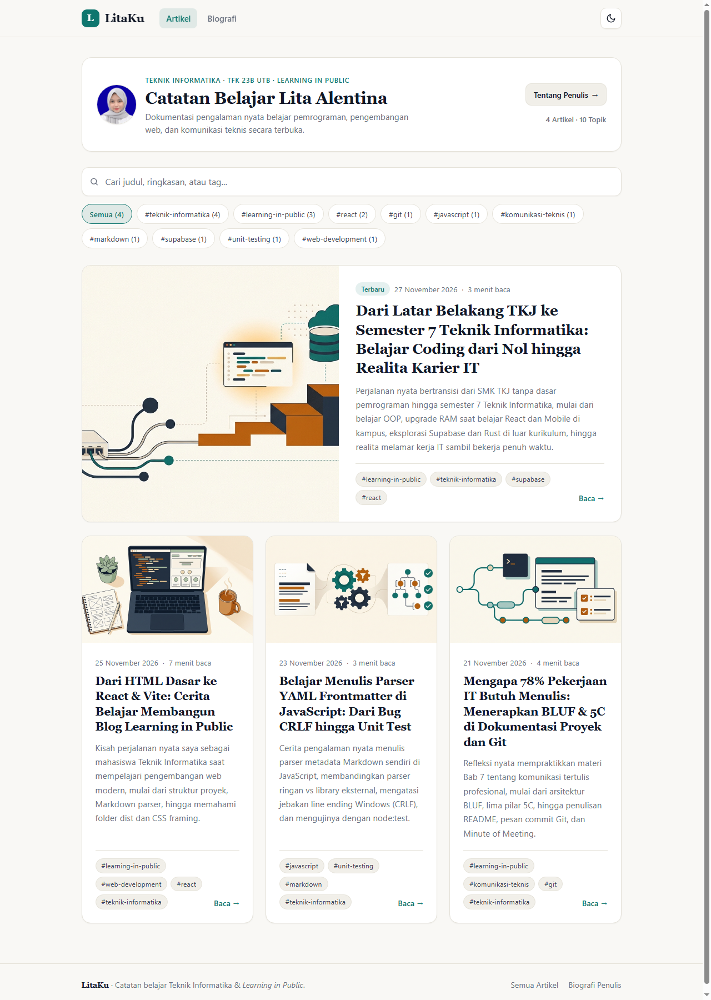
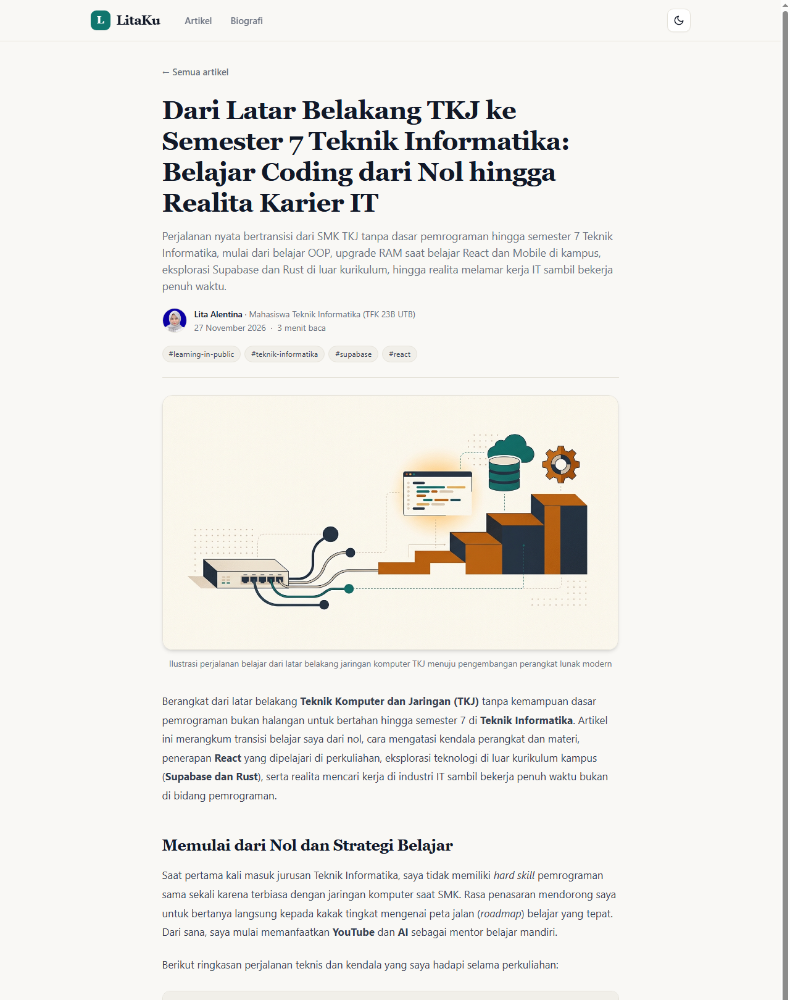
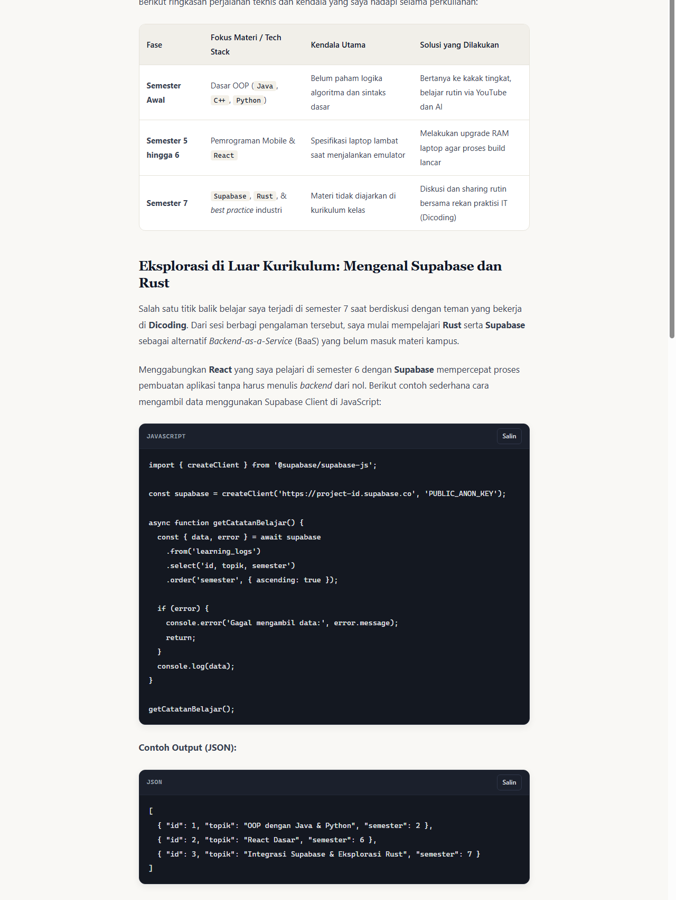
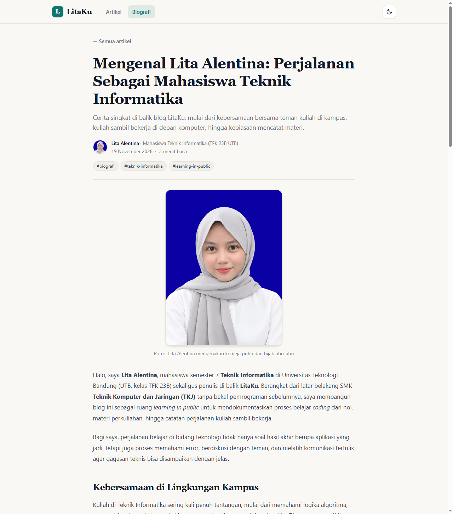

<div align="center">

# LitaKu | Blog *Learning in Public* Teknik Informatika

**Dokumentasi perjalanan belajar pemrograman, tantangan teknis perkuliahan, dan komunikasi tertulis profesional (*BLUF & 5C*).**


</div>

---

## Ringkasan Proyek (BLUF)

**LitaKu** adalah aplikasi web blog pribadi berbasis **React, Vite, Tailwind CSS, dan Markdown** yang disusun untuk memenuhi tugas **Bab 7 (Komunikasi Tertulis Profesional & *Learning in Public*)**. Seluruh artikel ditulis dalam format cerita pengalaman nyata (*storytelling*) lengkap dengan potongan source code, output eksekusi, tabel perbandingan teknologi, serta referensi sumber.

| Informasi Akademik | Detail |
| :--- | :--- |
| **Penulis** | Lita Alentina |
| **Program Studi** | Teknik Informatika (Semester 7) |
| **Kelas & Kampus** | TFK 23B, Universitas Teknologi Bandung (UTB) |
| **Fokus Tugas** | Artikel storytelling pengalaman belajar IT dengan tata bahasa BLUF & 5C |

---

## Daftar Artikel & Konten Utama

| No | Judul Artikel | Fokus Pembahasan | Elemen Pendukung |
| :-: | :--- | :--- | :--- |
| 1 | **[Dari Latar Belakang TKJ ke Semester 7 Teknik Informatika](articles/dari-tkj-ke-semester-7-teknik-informatika.md)** | Transisi belajar coding dari nol, kendala laptop, React di kampus, eksplorasi Supabase & Rust, serta realita kuliah sambil bekerja | Tabel perjalanan belajar, kode Supabase JS, output JSON, foto aktivitas kerja |
| 2 | **[Dari HTML Dasar ke React & Vite](articles/dari-html-dasar-ke-react-dan-vite.md)** | Membangun blog ini dari awal, memisahkan konten Markdown dari komponen UI, serta solusi bug folder `dist` & CSS framing | Tabel komparasi stack, diagram alur arsitektur SVG, output CLI & JSON |
| 3 | **[Belajar Menulis Parser YAML Frontmatter di JavaScript](articles/membangun-parser-yaml-frontmatter-tanpa-library.md)** | Menulis parser metadata Markdown ringan, mengatasi bug `CRLF` Windows, dan membuat unit test | Perbandingan parser vs library, kode RegExp, output `node --test` |
| 4 | **[Mengapa 78% Pekerjaan IT Butuh Menulis](articles/menerapkan-komunikasi-teknis-bab-7-di-git-dan-readme.md)** | Penerapan langsung materi Bab 7 (BLUF & 5C) pada pesan tim, pesan commit Git, `README.md`, dan MoM | Tabel pesan sebelum vs sesudah BLUF, output `git log`, checklist komunikasi |
| 5 | **[Biografi Penulis](articles/biografi-penulis.md)** | Profil lengkap penulis, latar belakang kampus, serta prinsip belajar mandiri *(di menu Biografi)* | Foto profil, kebersamaan kampus, aktivitas kerja, dan catatan belajar |

---

## Pratinjau Tampilan Aplikasi

<table>
  <tr>
    <td width="50%" align="center">
      <strong>Halaman Beranda (Artikel &amp; Filter Topik)</strong><br/><br/>
      
    </td>
    <td width="50%" align="center">
      <strong>Halaman Artikel Utama (Gaya Medium / dev.to)</strong><br/><br/>
      
    </td>
  </tr>
  <tr>
    <td width="50%" align="center">
      <strong>Tabel Perjalanan, Blok Kode &amp; Output JSON</strong><br/><br/>
      
    </td>
    <td width="50%" align="center">
      <strong>Halaman Biografi Penulis</strong><br/><br/>
      
    </td>
  </tr>
</table>

---

## Fitur Utama & Arsitektur Teknis

- **Blog Berbasis Markdown + Frontmatter:** Artikel disimpan di `articles/*.md` dan dimuat otomatis oleh Vite melalui `import.meta.glob`, kemudian diurai oleh parser ringan tanpa dependensi eksternal ([`src/utils/frontmatter.js`](src/utils/frontmatter.js)).
- **Blok Kode & Output Interaktif:** Komponen [`MarkdownRenderer.jsx`](src/components/MarkdownRenderer.jsx) menampilkan source code dengan label bahasa, gaya khusus untuk blok `Output`, serta tombol **Salin** satu klik.
- **Pencarian & Filter Tag Real-Time:** Memudahkan pembaca mencari artikel berdasarkan kata kunci judul, ringkasan, maupun topik tag ([`SearchAndFilter.jsx`](src/components/SearchAndFilter.jsx)).
- **Kenyamanan Membaca:** Dilengkapi *Reading Progress Bar* di bagian atas artikel, estimasi waktu baca otomatis, navigasi artikel sebelumnya dan berikutnya, serta dukungan **Light / Dark Mode** yang tersimpan di `localStorage`.
- **Teruji Otomatis:** Dilengkapi 15 unit test (`node --test`) dan pengecekan kualitas kode (`oxlint`).

---

## Panduan Menjalankan Proyek (Untuk Dosen / Reviewer)

Pastikan **Node.js** (disarankan versi 18 atau 20+) dan **npm** sudah terpasang di perangkat Anda.

### 1. Clone Repository & Masuk ke Folder Proyek
```bash
git clone https://github.com/LitaAlentina287/litaku-blog.git
cd litaku-blog
```
*(Sesuaikan `litaku-blog` dengan nama repository jika berbeda.)*

### 2. Install Dependencies
```bash
npm install
```

### 3. Jalankan Server Development
```bash
npm run dev
```
Setelah berjalan, buka URL lokal yang tampil di terminal (umumnya `http://localhost:5173`).

### 4. Perintah Pengujian, Lint, dan Build Produksi
```bash
npm test        # Menjalankan 15 unit test (node --test tests/*.test.js)
npm run lint    # Memeriksa kualitas kode menggunakan Oxlint
npm run build   # Membungkus aplikasi siap produksi ke folder dist/
npm run preview # Menjalankan pratinjau hasil build dari folder dist/
```

---

## Struktur Direktori

```text
├── articles/
│   ├── images/                # Foto pribadi, ilustrasi sampul, & diagram arsitektur SVG
│   └── *.md                   # Konten artikel blog & halaman biografi (YAML frontmatter)
├── docs/
│   └── screenshots/           # Screenshot antarmuka aplikasi untuk dokumentasi README
├── public/
│   └── favicon.svg            # Ikon tab browser
├── src/
│   ├── components/            # AuthorHero, ArticleCard, Layout, MarkdownRenderer, ThemeSwitcher, dll.
│   ├── lib/                   # Loader artikel (import.meta.glob), helper filter/tanggal, & tema
│   ├── pages/                 # HomePage, ArticlePage, NotFoundPage
│   └── utils/                 # Parser YAML frontmatter & penghitung estimasi waktu baca
├── tests/                     # Unit test untuk artikel, frontmatter parser, dan tema
├── index.html
├── package.json
└── vite.config.js
```

---

## Catatan Keamanan & Kualitas Kode

- Seluruh kode contoh integrasi API (seperti Supabase Client) hanya menggunakan placeholder URL dan key publik dummy, tanpa kredensial atau data rahasia asli.
- Folder `node_modules/` dan `dist/` diabaikan melalui `.gitignore` agar repositori tetap bersih dan ringan saat di-clone.
