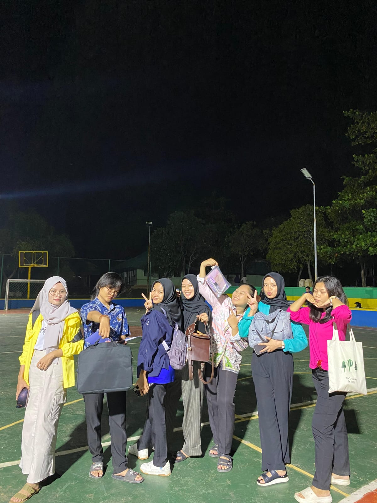
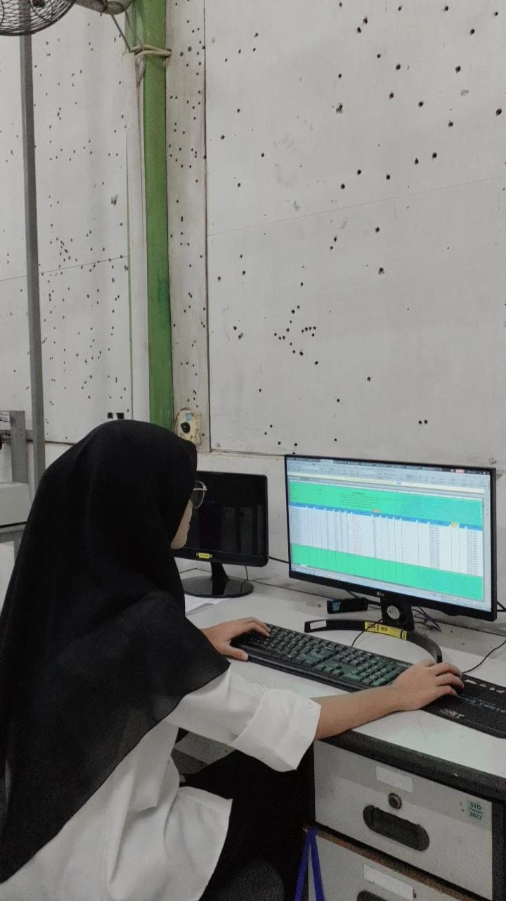
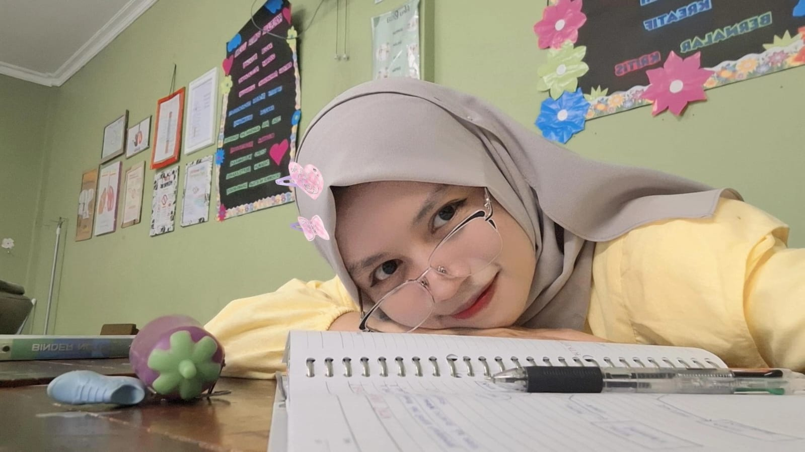

Halo, saya **Lita Alentina**, mahasiswa semester 7 **Teknik Informatika** di Universitas Teknologi Bandung (UTB, kelas TFK 23B) sekaligus penulis di balik **LitaKu**. Berangkat dari latar belakang SMK **Teknik Komputer dan Jaringan (TKJ)** tanpa bekal pemrograman sebelumnya, saya membangun blog ini sebagai ruang *learning in public* untuk mendokumentasikan proses belajar *coding* dari nol, materi perkuliahan, hingga catatan perjalanan kuliah sambil bekerja.

Bagi saya, perjalanan belajar di bidang teknologi tidak hanya soal hasil akhir berupa aplikasi yang jadi, tetapi juga proses memahami error, berdiskusi dengan teman, dan melatih komunikasi tertulis agar gagasan teknis bisa disampaikan dengan jelas.

## Kebersamaan di Lingkungan Kampus

Kuliah di Teknik Informatika sering kali penuh tantangan, mulai dari memahami logika algoritma, mengerjakan tugas kelompok, hingga menyelesaikan proyek tepat waktu. Di momen seperti itu, kebersamaan dengan teman satu kampus menjadi bagian yang paling berharga.

Berada di lingkungan teman yang saling menyemangati membuat proses belajar terasa jauh lebih ringan. Banyak pemahaman baru justru muncul dari diskusi santai setelah kelas selesai atau saat berkumpul di kampus bersama rekan seperjuangan.

## Kuliah Sambil Bekerja & Praktik di Depan Layar

Selain mengikuti perkuliahan, saya juga bekerja penuh waktu bukan di bidang pemrograman untuk membantu meringankan beban orang tua. Di sela kesibukan kerja dan mengolah data di depan layar komputer, saya tetap menyempatkan waktu mempraktikkan **React** yang dipelajari di kampus, mengeksplorasi teknologi di luar kurikulum seperti **Supabase** dan **Rust**, serta membangun portofolio sedikit demi sedikit.

Dari rutinitas praktik tersebut, ada tiga prinsip sederhana yang selalu saya pegang saat belajar teknologi baru:

1. **Mulai dari memahami alurnya:** Tidak sekadar menyalin kode, tetapi mengerti mengapa kode itu bekerja.
2. **Catat setiap masalah dan solusinya:** Error yang hari ini membingungkan bisa menjadi pelajaran berharga di proyek berikutnya.
3. **Konsisten membangun sedikit demi sedikit:** Kemajuan kecil setiap hari jauh lebih berarti daripada menunggu semuanya sempurna.

> "Kemampuan teknis akan semakin kuat ketika dibarengi kebiasaan mendokumentasikan prosesnya dengan jujur dan terstruktur."

## Kebiasaan Mencatat & Belajar Mandiri

Sebelum menuliskan kode atau menyusun artikel di blog, saya masih sering memulai dari buku catatan fisik. Menulis poin inti dengan tangan membantu saya menyusun kerangka berpikir sebelum menuangkannya ke format digital seperti Markdown.

Kebiasaan merangkum inilah yang melatih saya untuk menulis lebih terstruktur, yang menjadi keterampilan komunikasi tertulis penting bagi mahasiswa Teknik Informatika saat menyusun dokumentasi proyek maupun berbagi pengalaman belajar secara terbuka.

## Ringkasan Pilar Belajar di LitaKu

| Aspek | Aktivitas Utama | Tujuan Jangka Panjang |
| :--- | :--- | :--- |
| **Perkuliahan & Diskusi** | Mempelajari dasar ilmu komputer & kolaborasi tim | Memperkuat fondasi teori dan kerja sama |
| **Praktik & Eksperimen** | Membangun proyek web, ngoding & debugging | Mengasah keterampilan teknis secara nyata |
| **Learning in Public** | Menulis catatan & storytelling di blog **LitaKu** | Melatih komunikasi tertulis profesional & personal branding |

Terima kasih sudah berkunjung dan membaca profil singkat ini. Semoga catatan belajar di **LitaKu** bisa menjadi dokumentasi yang bermanfaat bagi perjalanan akademik dan profesional ke depannya.
