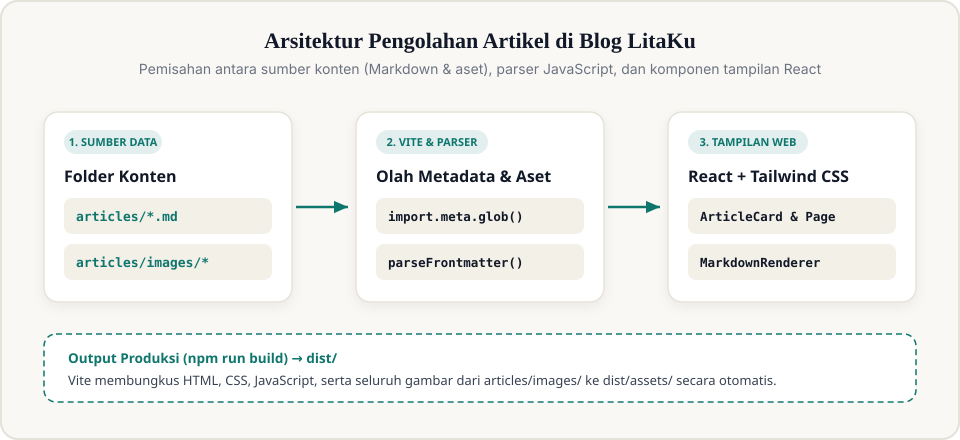

Sebagai mahasiswa semester 7 Teknik Informatika di Universitas Teknologi Bandung (UTB), saya memanfaatkan **React** yang sudah dipelajari di perkuliahan lalu memadukannya dengan **Vite, Tailwind CSS, dan Markdown** untuk membangun blog **LitaKu** sebagai ruang *learning in public*. Dari materi perkuliahan Bab 7 tentang komunikasi tertulis profesional, saya belajar bahwa **78% komunikasi di bidang teknologi dilakukan secara tertulis** (mulai dari dokumentasi, tiket isu, hingga catatan proyek), sehingga tulisan teknis perlu menerapkan pendekatan **BLUF (*Bottom Line Up Front*)** serta lima pilar **5C (*Clear, Concise, Concrete, Correct, Courteous*)**.

Artikel ini merangkum perjalanan nyata saya saat beralih dari halaman HTML statis ke proyek React dan Vite, membandingkan pilihan teknologi yang tersedia, menyelesaikan error aset gambar serta CSS framing, hingga memverifikasi hasil build dan pengujian otomatis.

## Babak 1: Memilih Teknologi dan Memahami Struktur Proyek

Saat mendapat tugas membuat blog cerita pembelajaran TI, saya sempat menimbang beberapa pendekatan teknologi sebelum memutuskan menggunakan React dan Vite:

| Opsi Teknologi | Kelebihan | Kekurangan | Alasan Pilihan |
| :--- | :--- | :--- | :--- |
| **HTML & CSS Statis** | Sangat ringan, langsung buka di browser | Tag HTML harus diduplikasi tiap artikel baru | Kurang praktis jika artikel terus bertambah |
| **React + Vite + Markdown** | Komponen UI reusable, build cepat, artikel cukup ditulis di `.md` | Perlu `npm install` dan memahami struktur folder | **Dipilih:** pas untuk blog modern yang mudah dirawat & dijalankan dari GitHub |
| **Next.js (Full-stack/SSR)** | Mendukung SSR, routing otomatis, skala besar | Setup lebih kompleks untuk blog portofolio sederhana | Belum diperlukan karena artikel cukup di-bundle statis |

Begitu membuka proyek React dan Vite, struktur foldernya jelas berbeda dari satu file `index.html` biasa karena terdapat `package.json`, `vite.config.js`, folder `src/`, `articles/`, dan `tests/`. Hal pertama yang sempat membuat saya terhenti adalah saat mencoba menjalankannya: dependensi harus dipasang terlebih dahulu lewat terminal sebelum server pengembangan bisa menyala:

```powershell
npm install
npm run dev
```

Setelah dijalankan, Vite langsung menampilkan server lokal beserta *Hot Module Replacement* (HMR) sehingga perubahan di file kode atau artikel langsung terlihat di browser:

```output
  VITE v8.4.0  ready in 312 ms

  ➜  Local:   http://localhost:5173/
  ➜  Network: use --host to expose
```

Dari sini saya memahami peran **komponen React** (`Layout.jsx`, `AuthorHero.jsx`, `ArticleCard.jsx`, dan `SearchAndFilter.jsx`). Alih-alih menyalin ulang header dan footer ke setiap halaman, cukup perbarui satu komponen dan seluruh halaman ikut berubah konsisten.

## Babak 2: Memisahkan Isi Tulisan (Markdown) dari Kode Tampilan

Salah satu bagian yang paling menarik bagi saya adalah bagaimana artikel di blog ini ditulis. Alih-alih mengetik tag `<p>`, `<h2>`, atau `` satu per satu untuk setiap tulisan baru, semua artikel cukup ditulis sebagai file `.md` biasa di folder `articles/`, lengkap dengan metadata (*frontmatter*) di bagian atas:

```yaml
---
title: "Dari HTML Dasar ke React & Vite"
date: "2026-11-27"
summary: "Ringkasan singkat isi artikel."
tags: ["learning-in-public", "web-development"]
cover: "./images/cover-web-react.jpg"
---
```

Di sisi aplikasi React, file-file Markdown tersebut dibaca secara otomatis menggunakan fitur `import.meta.glob` milik Vite di `src/lib/articles.js`, lalu diurai (*parsing*) metadata dan isi tulisannya oleh fungsi `parseFrontmatter`:

```js
const rawArticleFiles = import.meta.glob('/articles/*.md', {
  query: '?raw',
  import: 'default',
  eager: true,
})
```

Ketika file Markdown diproses oleh `parseFrontmatter()` dan `buildArticleList()`, **output data terstruktur** yang diterima komponen React berbentuk seperti ini:

```json
{
  "slug": "dari-html-dasar-ke-react-dan-vite",
  "title": "Dari HTML Dasar ke React & Vite",
  "date": "2026-11-27",
  "tags": ["learning-in-public", "web-development"],
  "cover": "/assets/cover-web-react-Di-b3HxJ.jpg",
  "readingTime": 4
}
```

Melihat alur input, proses, dan output ini membuat saya benar-benar paham konsep **pemisahan antara konten dan presentasi** (*separation of concerns*). Menulis artikel baru kini semudah membuat satu file `.md` tanpa perlu menyentuh kode React sama sekali.



## Babak 3: Pelajaran Penting Soal `articles/images/` vs `dist/assets/`

Tidak semua proses belajar berjalan mulus. Salah satu momen paling berkesan sekaligus pelajaran teknis yang sangat penting terjadi ketika saya mengganti foto bawaan proyek dengan foto pribadi saya sendiri.

Awalnya saya menaruh file foto `.jpeg` saya ke dalam folder `dist/assets/` karena di sanalah saya sempat melihat file gambar berada. Ternyata, foto tersebut tidak otomatis tampil saat proyek dijalankan maupun saat di-build!

Di situlah saya baru benar-benar memahami perbedaan antara **folder sumber (*source*)** dan **folder hasil build (`dist`)**:

- **`articles/images/`** adalah folder sumber tempat aset gambar asli disimpan agar dibaca oleh Vite saat development (`npm run dev`) maupun build.
- **`dist/`** adalah folder keluaran (*output*) hasil perintah `npm run build` yang isinya disusun ulang oleh Vite, sehingga menaruh file langsung di `dist/` justru berisiko terhapus atau tertimpa saat build berikutnya dijalankan.

Selain itu, karena sebelumnya kode `getProfileImage()` di `src/lib/articles.js` masih mencari file bernama `./images/profile.jpg` sementara foto saya berekstensi `.jpeg`, referensi path-nya juga harus disesuaikan agar Vite dapat me-resolve aset dengan benar.

## Babak 4: Mengatur Framing Foto Potret dengan CSS

Setelah gambar berhasil muncul, muncul tantangan visual berikutnya: beberapa foto saya berbentuk **potret (vertikal)**, seperti rasio `3:4` dan `9:16`. Ketika dimasukkan ke wadah kartu artikel (`aspect-[16/10]`) atau ke dalam isi artikel dengan aturan `object-fit: cover` dan `max-height`, bagian atas atau subjek utama foto berisiko terpotong.

Dari masalah kecil ini saya belajar dua properti CSS yang sangat berguna:

```css
/* Menampilkan gambar di dalam artikel secara utuh tanpa terpotong */
.prose .prose-image {
  display: block;
  width: auto;
  max-width: 100%;
  height: auto;
  max-height: 540px;
  margin-inline: auto;
}
```

Sedangkan untuk gambar sampul (*cover*) pada kartu artikel yang tetap harus mengisi kotak `16:10`, saya menambahkan dukungan properti `coverPosition` di frontmatter artikel untuk mengatur `object-position` CSS (misalnya `center 72%` atau `center 20%`). Dengan begitu, bagian wajah dan objek utama tetap berada tepat di tengah bingkai.

## Babak 5: Pengujian & Verifikasi Output Build

Untuk memastikan semua fungsi parser, filter tag, manajemen tema, dan bundling gambar berjalan tanpa error (*concrete* dan *correct*), saya menjalankan skrip pengecekan otomatis dan build produksi:

```powershell
npm test
npm run lint
npm run build
```

Output terminal menunjukkan seluruh **15 unit test** lulus, **0 error lint**, dan seluruh aset berhasil dikemas ke folder `dist/`:

```output
✔ tests 15 | pass 15 | fail 0
✔ oxlint: Found 0 warnings and 0 errors (20 files)
✔ vite build: built in ~500ms → dist/index.html + dist/assets/*
```

## Ringkasan Hal Teknis yang Saya Pelajari

| Topik / Teknologi | Peran di Blog Ini | Pelajaran Utama yang Didapat |
| :--- | :--- | :--- |
| **HTML & JSX** | Struktur semantik halaman (`header`, `main`, `article`, `aside`, `footer`) | Struktur semantik membuat web lebih rapi, mudah diakses, dan mudah dirawat |
| **React & Router** | Komponen antarmuka & navigasi multi-halaman (`/`, `/artikel/:slug`) | Membagi UI menjadi komponen kecil mengurangi duplikasi kode |
| **Vite (`import.meta.glob`)** | Dev server & bundler aset statis | Membedakan folder kode sumber (`src/`, `articles/`) dan folder build (`dist/`) |
| **Tailwind CSS & CSS Variables** | Styling responsif & tema terang/gelap (`[data-theme='dark']`) | `object-fit` dan `object-position` krusial untuk menangani foto potret dan lanskap |
| **Markdown + Frontmatter** | Sumber data artikel dan metadata (`title`, `date`, `tags`, `cover`) | Memisahkan konten tulisan dari logika aplikasi membuat pengelolaan blog jauh lebih cepat |
| **Node Test & Oxlint** | Pengujian unit parser & pengecekan kualitas kode (`npm test`, `npm run lint`) | Memastikan perubahan fitur baru tidak merusak fungsi yang sudah berjalan |

> "Menulis dokumentasi saat belajar bukan berarti harus menunggu sempurna. Justru dari kesalahan kecil dan cara kita menyelesaikannya, pemahaman teknis terbentuk paling kuat."

## Penutup: Mengapa *Learning in Public* Itu Berharga

Mengerjakan blog ini mengajarkan saya bahwa belajar pemrograman tidak berhenti ketika kode berhasil jalan di layar. Ketika mencoba menuliskan kembali prosesnya langkah demi langkah, saya dipaksa untuk benar-benar memahami *kenapa* sebuah error muncul dan *bagaimana* solusinya bekerja.

Ke depannya, blog **LitaKu** akan terus saya isi dengan catatan perkuliahan Teknik Informatika, rangkuman materi pemrograman, dan dokumentasi proyek berikutnya. Semoga bermanfaat bagi siapa pun yang sedang menempuh perjalanan belajar yang sama.

## Referensi

- **Dokumentasi Resmi React:** Konsep komponen dan hooks ([react.dev](https://react.dev))
- **Dokumentasi Resmi Vite:** Fitur `import.meta.glob` dan mekanisme build ke `dist/` ([vite.dev](https://vite.dev))
- **Dokumentasi Tailwind CSS v4:** Utilitas layout responsif dan custom theme CSS ([tailwindcss.com](https://tailwindcss.com))
- **react-markdown & remark-gfm:** Rendering Markdown beserta tabel, checklist, dan blok kode ([github.com/remarkjs/react-markdown](https://github.com/remarkjs/react-markdown))
- **Materi Perkuliahan Bab 7 (TFK 23B, UTB):** Prinsip komunikasi tertulis TI (78% komunikasi tertulis, arsitektur BLUF, pilar 5C, serta etika sitasi dan transparansi sumber)
