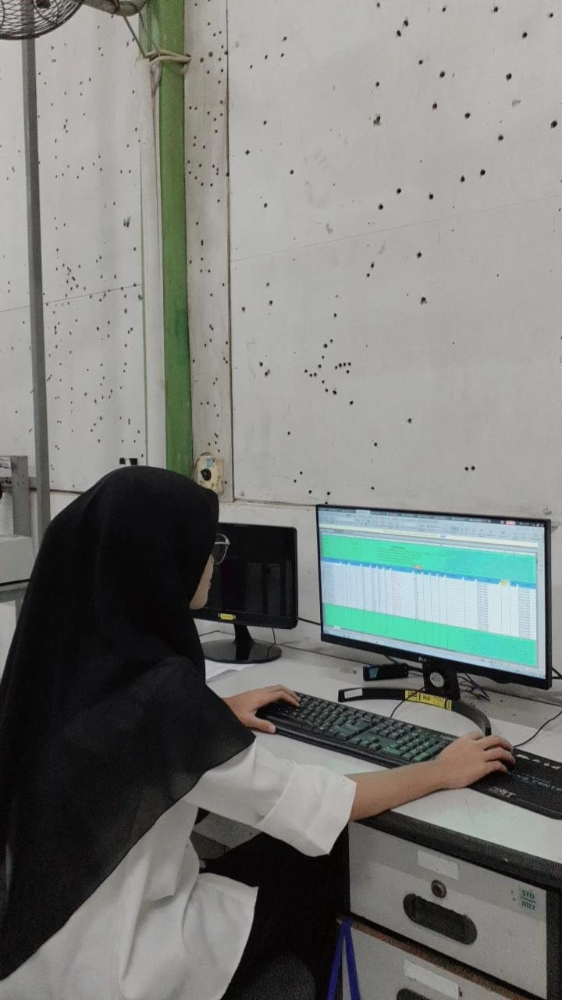

Berangkat dari latar belakang **Teknik Komputer dan Jaringan (TKJ)** tanpa kemampuan dasar pemrograman bukan halangan untuk bertahan hingga semester 7 di **Teknik Informatika**. Artikel ini merangkum transisi belajar saya dari nol, cara mengatasi kendala perangkat dan materi, penerapan **React** yang dipelajari di perkuliahan, eksplorasi teknologi di luar kurikulum kampus (**Supabase dan Rust**), serta realita mencari kerja di industri IT sambil bekerja penuh waktu bukan di bidang pemrograman.

## Memulai dari Nol dan Strategi Belajar

Saat pertama kali masuk jurusan Teknik Informatika, saya tidak memiliki *hard skill* pemrograman sama sekali karena terbiasa dengan jaringan komputer saat SMK. Rasa penasaran mendorong saya untuk bertanya langsung kepada kakak tingkat mengenai peta jalan (*roadmap*) belajar yang tepat. Dari sana, saya mulai memanfaatkan **YouTube** dan **AI** sebagai mentor belajar mandiri.

Berikut ringkasan perjalanan teknis dan kendala yang saya hadapi selama perkuliahan:

| Fase | Fokus Materi / Tech Stack | Kendala Utama | Solusi yang Dilakukan |
| :--- | :--- | :--- | :--- |
| **Semester Awal** | Dasar OOP (`Java`, `C++`, `Python`) | Belum paham logika algoritma dan sintaks dasar | Bertanya ke kakak tingkat, belajar rutin via YouTube dan AI |
| **Semester 5 hingga 6** | Pemrograman Mobile & `React` | Spesifikasi laptop lambat saat menjalankan emulator | Melakukan upgrade RAM laptop agar proses build lancar |
| **Semester 7** | `Supabase`, `Rust`, & *best practice* industri | Materi tidak diajarkan di kurikulum kelas | Diskusi dan sharing rutin bersama rekan praktisi IT (Dicoding) |

## Eksplorasi di Luar Kurikulum: Mengenal Supabase dan Rust

Salah satu titik balik belajar saya terjadi di semester 7 saat berdiskusi dengan teman yang bekerja di **Dicoding**. Dari sesi berbagi pengalaman tersebut, saya mulai mempelajari **Rust** serta **Supabase** sebagai alternatif *Backend-as-a-Service* (BaaS) yang belum masuk materi kampus.

Menggabungkan **React** yang saya pelajari di semester 6 dengan **Supabase** mempercepat proses pembuatan aplikasi tanpa harus menulis *backend* dari nol. Berikut contoh sederhana cara mengambil data menggunakan Supabase Client di JavaScript:

```js
import { createClient } from '@supabase/supabase-js';

const supabase = createClient('https://project-id.supabase.co', 'PUBLIC_ANON_KEY');

async function getCatatanBelajar() {
  const { data, error } = await supabase
    .from('learning_logs')
    .select('id, topik, semester')
    .order('semester', { ascending: true });

  if (error) {
    console.error('Gagal mengambil data:', error.message);
    return;
  }
  console.log(data);
}

getCatatanBelajar();
```

**Contoh Output (JSON):**

```json
[
  { "id": 1, "topik": "OOP dengan Java & Python", "semester": 2 },
  { "id": 2, "topik": "React Dasar", "semester": 6 },
  { "id": 3, "topik": "Integrasi Supabase & Eksplorasi Rust", "semester": 7 }
]
```

> *(Catatan keamanan data: Untuk menjaga kerahasiaan proyek, URL proyek dan kunci API asli tidak ditampilkan di publik dan sebaiknya disimpan di dalam file `.env` yang diabaikan oleh `.gitignore`.)*

## Realita Kuliah Sambil Bekerja dan Persaingan Rekrutmen IT

Saat ini saya berkuliah sambil bekerja penuh waktu bukan di bidang pemrograman demi membantu meringankan beban orang tua. Meski kesibukan harian terbagi antara pekerjaan dan tugas kuliah, saya tetap meluangkan waktu di depan komputer untuk mengasah keterampilan dan mencoba menguji kemampuan dengan melamar secara daring ke dua lowongan IT, yakni posisi **Web Developer** dan **Mobile Developer**.



Dari pengalaman tersebut, ada dua pelajaran penting mengenai kondisi pasar kerja *entry-level* IT saat ini:

1. **Rasio persaingan sangat ketat:** Dari ribuan pelamar yang mendaftar secara daring, saya sempat masuk ke tahap **500 besar** sebelum seleksi terus dipersempit hingga menyisakan satu orang terpilih.
2. **Pertimbangan kompensasi yang realistis:** Setelah menelusuri kisaran gaji untuk posisi *entry-level* tersebut, angkanya ternyata masih berada di bawah penghasilan dari pekerjaan saya saat ini yang bukan di bidang pemrograman.

Pengalaman ini tidak membuat saya berhenti belajar *coding*, melainkan mengubah strategi saya. Fokus saya sekarang bukan asal masuk ke industri IT dengan terburu-buru, melainkan **mematangkan portofolio dan kemampuan teknis terlebih dahulu** agar kelak bisa melamar pada posisi yang lebih sepadan secara karier maupun finansial.

## Referensi

- **Dokumentasi Resmi Supabase (JavaScript Client):** [supabase.com/docs/reference/javascript](https://supabase.com/docs/reference/javascript)
- **Dokumentasi Resmi React:** [react.dev](https://react.dev) dan **Rust Language:** [rust-lang.org](https://www.rust-lang.org)
- **Materi Perkuliahan Bab 7 (Kelas TFK 23B, UTB):** Prinsip penulisan BLUF, pilar 5C, serta kesadaran kerahasiaan data dan kunci API
